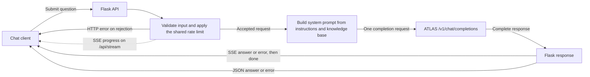

# BLS Virtual Advisor

The BLS Virtual Advisor is an AI-powered chatbot for the University of Illinois Bachelor of Liberal Studies (BLS) program. It answers questions about admissions, tuition, transfer credits, concentrations, and academic advising using the program's knowledge base.

- **Full-page chat and embeddable widget.** Open the advisor directly or add the floating widget to another site using the iframe loader. The repository also includes a Next.js widget.
- **Single-hop ATLAS LLM integration.** Flask makes one OpenAI-compatible ATLAS completion request per accepted question, using the BLS instructions and knowledge base as the system prompt.
- **Real-time status streaming.** The Flask-served HTML clients receive progress updates via server-sent events (SSE), followed by the complete answer once ATLAS returns it.
- **Optimistic UI message rendering.** The chat shows the submitted question and a typing indicator immediately. If the request fails, the chat removes the pending entries and restores the question to the input for retry.
- **Stratified randomized suggested questions.** Each chat loads up to four clickable prompts from a shared question bank. The picker randomly selects one question from each of up to four distinct categories, then fills any remaining slots with unique questions.

The Flask service and web interfaces are based on [ATLAS-Illinois/bls-chatbot](https://github.com/ATLAS-Illinois/bls-chatbot). The shared ATLAS client follows the request format from [UIUCATLAS/chat_illinois_cli](https://github.com/UIUCATLAS/chat_illinois_cli).

## Architecture



The full-page HTML chat and iframe widget use `/api/stream`. Once the stream opens, Flask sends `agent_status` events, followed by one `answer` or `error` event and a `done` event. The JSON endpoints support the Next.js widget and other clients that expect a complete JSON response.

[`atlas_chat.py`](atlas_chat.py) uses Python's standard-library HTTP client. It sends the system prompt and current question with the configured `model`, `temperature`, and `reasoning_effort`. When enabled and supplied, the previous assistant answer goes before the current question. The client reads the answer from `choices[0].message.content`.

## Quick Start

Run these steps from the repository root.

1. Create and activate a Python virtual environment.

   **PowerShell**

   ```powershell
   python -m venv .venv
   .\.venv\Scripts\Activate.ps1
   ```

   **macOS or Linux**

   ```bash
   python3 -m venv .venv
   source .venv/bin/activate
   ```

2. Install the dependencies.

   ```sh
   python -m pip install -r requirements.txt
   ```

3. Copy `.env.example` to `.env` (`Copy-Item .env.example .env` in PowerShell or `cp .env.example .env` on macOS or Linux). Set `ATLAS_API_KEY` to the token supplied through PEAR.
4. Start Flask and open the [full-page chat](http://localhost:5001/).

   ```sh
   python app.py
   ```

Flask listens on port `5001`. Preview the [floating widget at `/widget`](http://localhost:5001/widget). To embed the widget on a host page, load the [`/embed.js` script](http://localhost:5001/embed.js) from the Flask server.

### Command-line client

The interactive CLI uses the same ATLAS client and configuration as Flask.

```sh
python bls_chat.py
```

`python scripts/bls_chat.py` is a compatibility entry point.

## Configuration

| Variable | Default | Description |
| --- | --- | --- |
| `ATLAS_API_KEY` | None | Bearer token supplied through PEAR, required for ATLAS requests |
| `ATLAS_API_URL` | `https://sequitor01.atlas.illinois.edu/v1/chat/completions` | ATLAS OpenAI-compatible endpoint |
| `ATLAS_MODEL` | `qwen3.8-27b` | Model served by the ATLAS server |
| `ATLAS_TEMPERATURE` | `0.1` | Sampling temperature from 0.0 to 2.0 |
| `ATLAS_REASONING_EFFORT` | `low` | Supported values are `low`, `medium`, and `xhigh` |
| `ATLAS_USE_LAST_RESPONSE` | `false` | Include the supplied previous assistant answer before the new user question |
| `ATLAS_INSTRUCTIONS_FILE` | `config/instructions.txt` | First part of the system prompt |
| `ATLAS_KNOWLEDGE_BASE_FILE` | `config/knowledgebase.md` | Markdown knowledge base appended to the instructions |
| `ATLAS_TIMEOUT_SECONDS` | `60` | ATLAS HTTP timeout in seconds, as a positive integer |
| `CHAT_MAX_QUESTION_CHARS` | `16000` | Maximum question length in Unicode code points, as an integer from 1 to 32,000 |
| `CHAT_RATE_LIMIT` | `10 per minute` | Per-client rate limit shared by the three chat routes |
| `RATELIMIT_STORAGE_URI` | `memory://` | Flask-Limiter storage backend |
| `CHAT_ALLOWED_ORIGINS` | Unset | Comma-separated list of exact browser origins allowed to call the API |

Flask and the CLI resolve relative prompt paths from the project root. The diagnostic response at `/api/config` exposes non-secret settings, including whether an API key is configured.

## API Endpoints

| Method | Endpoint | Description |
| --- | --- | --- |
| `GET` | `/` | Full-page BLS chat |
| `GET` | `/widget` | Floating chat widget |
| `GET` | `/embed.js` | Script that inserts the widget iframe |
| `GET` | `/assets/<path:filename>` | Static frontend assets, including the suggested-question bank |
| `GET` | `/api/config` | Non-secret ATLAS runtime settings |
| `GET` | `/api/input-config` | Active question and previous-answer length limits and the previous-answer context setting |
| `POST` | `/api/stream` | SSE progress updates followed by a complete answer or an error |
| `POST` | `/api/chat` | Widget JSON endpoint that returns `answer` and a `pipeline` value of `atlas_single_completion` |
| `POST` | `/api/ask` | Full-page compatibility endpoint that returns `answer` as JSON |

All three POST routes accept a JSON object with a nonblank `query` string. Include `last_response` only when `ATLAS_USE_LAST_RESPONSE` is enabled.

```json
{
  "query": "How much does the BLS program cost?",
  "last_response": "Optional previous assistant answer"
}
```

## Project Structure

```text
.
├── app.py                           # Flask routes and request controls
├── atlas_chat.py                    # Shared ATLAS completion client
├── bls_chat.py                      # Interactive CLI
├── config/
│   ├── instructions.txt             # System instructions
│   └── knowledgebase.md             # BLS program knowledge base
├── frontend/
│   ├── index.html                   # Full-page chat
│   ├── widget.html                  # Floating widget
│   ├── embed.js                     # Widget iframe loader
│   ├── embed-nextjs/                # Next.js widget
│   └── vendor/
│       ├── suggested-questions.json # Shared static question bank
│       └── suggested-questions.js   # Category-based random selection
├── scripts/
│   └── bls_chat.py                  # Compatibility CLI entry point
├── tests/                           # Python and Node regression suites
├── .env.example                     # Environment configuration template
├── Dockerfile                       # Gunicorn container
└── requirements.txt                 # Python dependencies
```

### Updating Content

- Edit [`config/instructions.txt`](config/instructions.txt) to change how the advisor responds.
- Edit [`config/knowledgebase.md`](config/knowledgebase.md) to update program facts and references.
- Edit [`frontend/vendor/suggested-questions.json`](frontend/vendor/suggested-questions.json) to update the clickable prompts. Each entry has a `question` string and a `category` string. Use distinct questions across at least four categories to keep all four suggestions drawn from different topics.

Flask reads the instructions and knowledge base on every completion request, so edits take effect without a restart. The HTML clients fetch the question bank when the page loads. The Next.js widget bundles the file, so rebuild and redeploy it to publish question-bank changes there.

## Security and Deployment

### Input limits and conversation context

- Chat routes enforce a 1 MiB request-body limit and a default question limit of 16,000 Unicode code points. Set `CHAT_MAX_QUESTION_CHARS` to an integer from 1 to 32,000. Invalid values prevent startup. The body limit accommodates a 32,000-code-point question and a 16,000-code-point previous answer even when supplementary Unicode characters are JSON-escaped, with room for normal request overhead.
- HTML and Next.js clients read the active limit from `/api/input-config`, count Unicode code points, preserve rejected drafts, and map known HTTP errors to safe messages.
- Previous-answer context is disabled by default, and the API ignores `last_response` in that mode. When enabled, the HTML clients send at most the latest assistant answer. If it exceeds 16,000 code points, they omit it entirely and notify the user. If a caller supplies an oversized previous answer, the API processes the question unchanged and signals the omission with `X-BLS-Context-Omitted: previous-response-too-long`. The Next.js widget sends only the current question.
- The model receives the system prompt, current question, and at most one previous assistant answer. For essay and other multi-turn follow-ups, repeat any relevant details from earlier messages.

### Rate limits and browser access

- All three chat routes share a limit of 10 requests per minute per client by default. Set `CHAT_RATE_LIMIT` to adjust it. In production, set `RATELIMIT_STORAGE_URI` to a shared Redis URI such as `redis://your-redis-host:6379/0`. The default `memory://` store is per worker and resets on restart.
- Flask-Limiter keys requests by the socket client address and ignores forwarded IP headers. Behind a reverse proxy, configure trusted proxy handling at the deployment layer. Otherwise, clients share the proxy's rate limit. Reject arbitrary client-supplied forwarding headers.
- Verify the scope and deployment configuration of any GPU-side rate limit before changing either layer's protection. Use edge or global limits as needed to protect GPU capacity from distributed traffic.
- CORS is disabled by default. The Flask-served HTML chat and iframe widget use same-origin API calls. For a separately hosted client, set `CHAT_ALLOWED_ORIGINS` to its exact origin or a comma-separated list of allowed origins. CORS governs browser access only.

### Response handling and hosting

- The HTML clients use locally vendored Marked and DOMPurify with a restricted formatting and link allowlist. Sanitization removes model-supplied images, scripts, styles, and event handlers. If the libraries fail to load, the renderer escapes the output as plain text. Keep the vendored dependencies up to date.
- The server logs internal service errors and returns generic messages to clients. API responses use `Cache-Control: no-store`.
- Use Gunicorn and serve the application over HTTPS in production. The supplied Dockerfile runs Gunicorn on port `5000`. The local `python app.py` launcher uses port `5001` with debug mode disabled.

## Testing

Run the tests from the repository root. They use mocked upstream responses and can run offline.

### Python

After installing `requirements.txt`, run the full suite or just the security regressions.

```sh
python -m unittest discover -s tests -v
python -m unittest discover -s tests -p "test_security.py" -v
```

Use the default `CHAT_RATE_LIMIT=10 per minute` and `RATELIMIT_STORAGE_URI=memory://` settings. The Flask test client and upstream mocks let the security suite run without an ATLAS API key, VPN, GPU server, or Redis instance. It covers malformed and oversized requests, input boundaries, provider-setting tampering, rate-limit bypass attempts, private error disclosure, upstream timeouts, file traversal, and SSE event injection.

[GitHub Actions](.github/workflows/python-tests.yml) runs the full Python suite on pushes and pull requests without repository secrets.

### Node.js

Use Node.js with a compatible `jsdom` installation. Replace `<path-to-jsdom-module>` with the module directory, such as `./node_modules/jsdom`.

```sh
node tests/test_input_frontend.cjs "<path-to-jsdom-module>"
node tests/test_safe_markdown.cjs "<path-to-jsdom-module>"
```

The frontend suite checks character counts, suggested questions, optimistic rendering, draft restoration, and retries for both HTML interfaces. The Markdown suite checks sanitization, including partial rendering in the widget.

Results, coverage limits, and an optional authorized live-evaluation procedure are documented in the [input validation report](INPUT_VALIDATION_REPORT.md).
