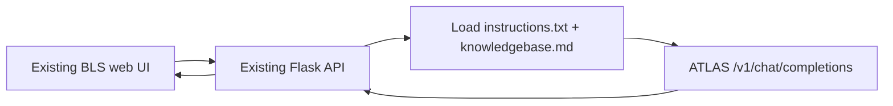

# BLS Virtual Advisor

An AI-powered web chatbot for the University of Illinois **Bachelor of Liberal Studies (BLS)** program.

The original Flask service, full-page chatbot interface, floating widget, embed script, and overall web design are based on the [ATLAS-Illinois/bls-chatbot](https://github.com/ATLAS-Illinois/bls-chatbot) repository.

The backend LLM integration and response pipeline have been updated based on [UIUCATLAS/chat_illinois_cli](https://github.com/UIUCATLAS/chat_illinois_cli). The updated implementation connects to the ATLAS LLM server using an OpenAI-compatible API and combines a local system prompt with a Markdown knowledge base to generate responses.

## Architecture



This replaces the previous dual-Agent/LangChain flow. There is no Agent A,
Agent B, `course_name`, `retrieval_only`, or second refinement request in the
active web path.

## Reference implementation

The ATLAS integration follows `chat_illinois_cli` at commit
`ab9826ae32db6d9fb02b8792fbb131b4d3c63481` (October 30, 2026):

- API: `https://sequitor01.atlas.illinois.edu/v1/chat/completions`
- Authentication: `Authorization: Bearer <PEAR key>`
- System prompt: `instructions.txt + "\n" + knowledgebase.md`
- Request parameters: `model`, `temperature`, and `reasoning_effort`
- Optional context: include the previous assistant answer when
  `ATLAS_USE_LAST_RESPONSE=true`
- Response: `choices[0].message.content`

The reusable adaptation is in [`atlas_chat.py`](atlas_chat.py). It uses only
Python standard-library HTTP code, as the reference CLI does.

## Setup

1. Create and activate a Python virtual environment.
2. Install dependencies:

   ```bash
   pip install -r requirements.txt
   ```

3. Copy `.env.example` to `.env`.
4. Put the API key supplied through PEAR in `ATLAS_API_KEY`.
5. Start Flask:

   ```bash
   python app.py
   ```

6. Open <http://localhost:5001>.

The floating widget remains at <http://localhost:5001/widget>, and the existing
embed script remains at <http://localhost:5001/embed.js>.

## Configuration

| Variable | Default | Description |
| --- | --- | --- |
| `ATLAS_API_KEY` | none | Required Bearer token supplied via PEAR |
| `ATLAS_API_URL` | `https://sequitor01.atlas.illinois.edu/v1/chat/completions` | ATLAS OpenAI-compatible endpoint |
| `ATLAS_MODEL` | `qwen3.8-27b` | Model served by the ATLAS server |
| `ATLAS_TEMPERATURE` | `0.1` | Sampling temperature from 0.0 to 2.0 |
| `ATLAS_REASONING_EFFORT` | `low` | Current supported values: `low`, `medium`, `xhigh` |
| `ATLAS_USE_LAST_RESPONSE` | `false` | Include the previous assistant answer before the new user question |
| `ATLAS_INSTRUCTIONS_FILE` | `config/instructions.txt` | First part of the system prompt |
| `ATLAS_KNOWLEDGE_BASE_FILE` | `config/knowledgebase.md` | Markdown knowledge base appended to the instructions |
| `ATLAS_TIMEOUT_SECONDS` | `60` | HTTP timeout |

Relative prompt paths are resolved from the project root, so startup does not
depend on the current working directory. `/api/config` returns the active
non-secret settings for diagnostics and never returns the key.

## Updating the prompt or knowledge base

Edit either:

- [`config/instructions.txt`](config/instructions.txt)
- [`config/knowledgebase.md`](config/knowledgebase.md)

The files are loaded for every request, matching the reference CLI's `reload`
workflow while allowing edits to take effect without restarting Flask.

## API endpoints

| Method | Endpoint | Description |
| --- | --- | --- |
| `GET` | `/` | Existing full-page BLS chat UI |
| `GET` | `/widget` | Existing floating widget UI |
| `GET` | `/embed.js` | Existing embeddable widget loader |
| `GET` | `/api/config` | Non-secret ATLAS runtime settings |
| `POST` | `/api/stream` | Existing SSE contract, backed by one ATLAS request |
| `POST` | `/api/chat` | Existing widget JSON fallback |
| `POST` | `/api/ask` | Existing full-page JSON fallback |

Request body:

```json
{
  "query": "How much does the BLS program cost?",
  "last_response": "Optional previous assistant answer"
}
```

`last_response` is ignored unless `ATLAS_USE_LAST_RESPONSE=true`.

## Command-line client

The CLI now shares the same client and configuration as Flask:

```bash
python bls_chat.py
```

`python scripts/bls_chat.py` remains available as a compatibility entry point.

## Project structure

```text
bls-chatbot/
├── app.py                       # Existing Flask routes, now using ATLAS
├── atlas_chat.py                # Adapted chat_illinois_cli request logic
├── bls_chat.py                  # Interactive CLI using the shared client
├── config/
│   ├── instructions.txt         # System instructions
│   └── knowledgebase.md         # BLS Markdown knowledge base
├── frontend/                    # Existing web UI and widget
├── scripts/bls_chat.py          # Compatibility CLI entry point
├── tests/                       # Unit and Flask contract tests
├── .env.example
└── requirements.txt
```
